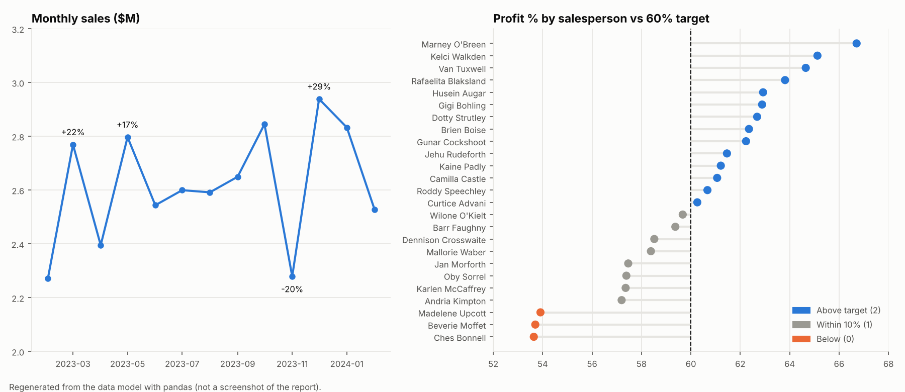

# Sales Performance Dashboard (Power BI)

[](https://github.com/sriharsha-d7/sales-performance-dashboard-powerbi/actions/workflows/ci.yml)

A Power BI report tracking chocolate-shipment sales, cost and profit across **6 countries, 25 salespeople, 22 products and
13 months** (Feb 2023 to Feb 2024), with a profit-target indicator per salesperson and a field-parameter slicer that
switches the main chart between Sales, Boxes, Shipments, Costs and Profit.

Open [`report/sales_report.pbix`](report/sales_report.pbix) in Power BI Desktop. The data is embedded in the file, so it
opens without any source workbook (refresh needs one; see [Limitations](#limitations)).



*Regenerated from the model's own data with pandas (`scripts/build_docs.py`); it is not a screenshot of the report.*

## Headline numbers (whole period)

| Measure | Value |
|---|---|
| Total sales | $34.04 M |
| Total costs | $13.52 M |
| Total profit | $20.52 M (**60.3%** margin vs a 60% target) |
| Shipments / boxes | 6,113 / 2,077,844 |
| Low-box shipments (< 50 boxes) | 10.2% of shipments |

These are recomputed independently in Python and pinned by the tests, so they match the model's DAX definitions.

## What is in the report

| Page | Contents |
|---|---|
| Page 1 | Month table: sales, previous-month sales, **MoM change %** |
| Page 2 (main) | KPI cards (sales, boxes, shipments, costs, profit); gauges for Profit % and low-box %; monthly sales line driven by the **measure selector**; shipment-size histogram (20-box bins); tables by salesperson and by product with the profit-target indicator; slicers for category and country |
| Page 3 | Donut by country |

Per-salesperson results: **14** are above the 60% margin target, **8** are within 10% of it, **3** are below that
(Madelene Upcott, Beverie Moffet, Ches Bonnell, all about 53.6-53.9%). Margin by country ranges from 57.2% (UK) to 62.4%
(Australia); by category, Bars 60.9%, Bites 61.2%, Other 57.5%.

## How the model works

A star schema: `shipments` (fact, 6,113 rows) joined many-to-one to `people`, `products`, `locations` and a date table.
Cost is a calculated column (`boxes x products[Cost per box]`), and there are 12 DAX measures plus a calculated
field-parameter table.

- [`docs/data_model.md`](docs/data_model.md): relationship diagram, table roles, source and refresh notes
- [`docs/measures.md`](docs/measures.md): every measure and column with its DAX and a plain-English meaning

Both are generated from the `.pbix` by `scripts/build_docs.py`, so they cannot drift from the report.

## Checks

```bash
pip install -r requirements.txt
pytest                             # 6 tests on the .pbix itself
python scripts/build_docs.py       # regenerate docs/ from the model
```

The tests verify the star schema, that no shipment references a missing person/product/country/date, that the Costs column
equals boxes x cost per box, that core DAX has not changed, and that headline KPIs and the salesperson indicator counts
match an independent pandas calculation. CI runs them on every push.

## Data and attribution

Everything comes from one Excel workbook, `ac-sample-data.xlsx` (not redistributed here). The salesperson photos in the model
link to `files.chandoo.org`, which indicates this is the public Power BI tutorial data set published by Chandoo.org. Credit
for the data belongs to its publisher.

## Data notes

- 4 shipments (about $26K of sales) record **0 boxes** with positive sales and zero cost, so they count as 100%-margin
  low-box shipments. One shipment has 157 boxes and **$0 sales**. The effect on totals is negligible.
- Sales per box ranges from $0 to $17,577 (median $18), so individual shipment margins are noisy; treat the salesperson
  ranking (margins between 53.6% and 66.7%) as indicative.
- 21% of shipments have cost above sales, even though the overall margin is 60%.

## Limitations

- **Refresh is tied to the author's machine.** Power Query reads the workbook from a hard-coded `C:\Users\...\Downloads\` path.
  Re-point it under *Data source settings* (or switch to a parameter) before refreshing elsewhere.
- The date table is named `calender` (a typo preserved in the model); pages are named "Page 1-3". Renaming needs Power BI Desktop.
- The Profit % target (60%) is a fixed measure, not a parameter, and Page 3's donut plots five measures of different scales
  (sales, boxes, shipments, costs, profit) together, which is hard to read.
- The report cannot be rendered in CI, so there is no screenshot of the live pages in this repository.
