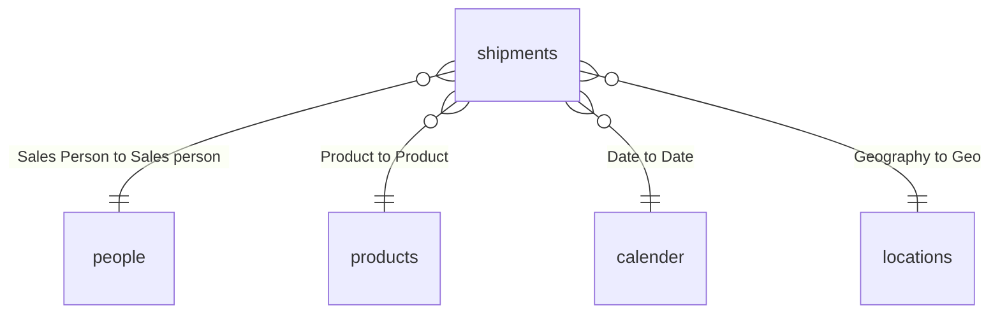

# Data model

Star schema: one fact table (`shipments`) and four dimensions, all many-to-one with single-direction filtering.

| Table | Rows | Role |
|---|---|---|
| `shipments` | 6,113 | fact: one row per shipment |
| `products` | 22 | dimension: product, category, cost per box |
| `people` | 25 | dimension: salesperson and team |
| `locations` | 6 | dimension: country and region |
| `calender` | 394 | date dimension (the table name is misspelled in the model) |

Shipments span **2023-02-01 to 2024-02-29**.

## Source and refresh

All tables are loaded by Power Query from one Excel workbook, `ac-sample-data.xlsx`, through a hard-coded path on the author's machine (`C:\Users\...\Downloads\...`). Refresh therefore fails anywhere else until the source is re-pointed (Transform data > Data source settings); the workbook is not included in this repository. The pictures in `people` link to `files.chandoo.org`, which indicates the data is Chandoo.org's public Power BI tutorial data set.
